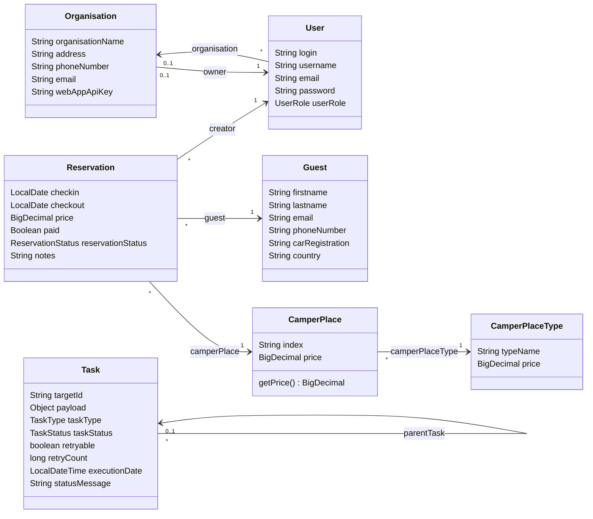
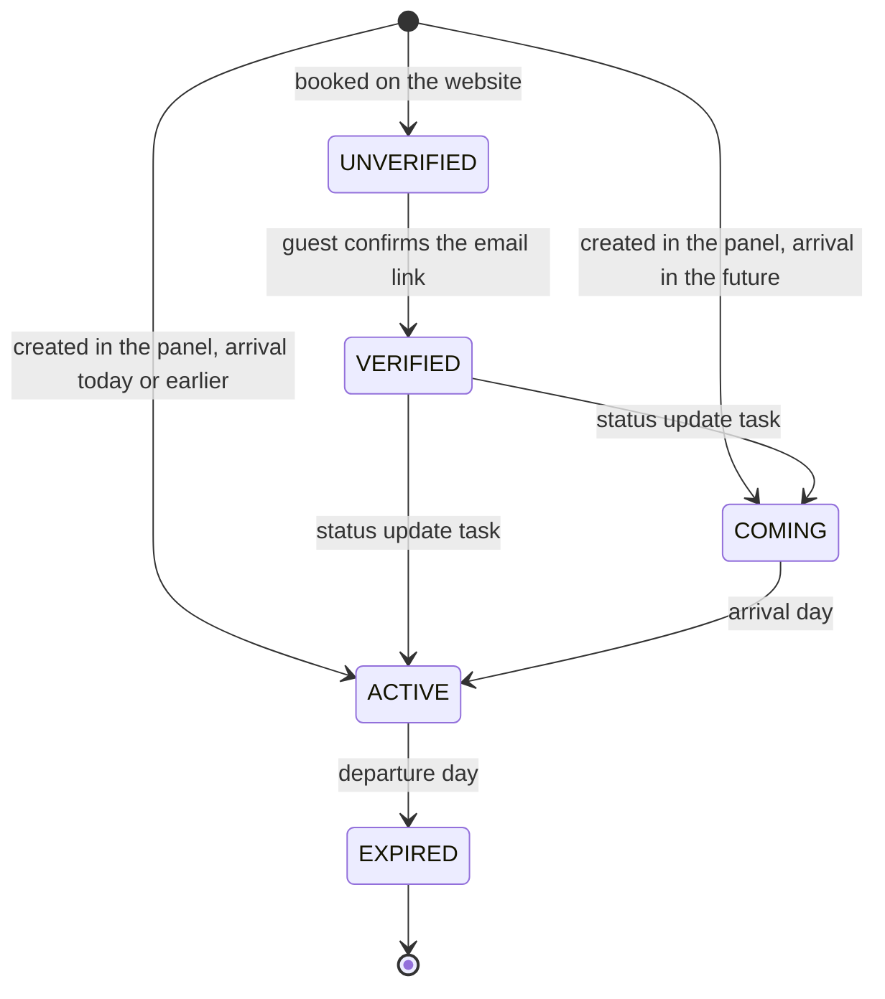
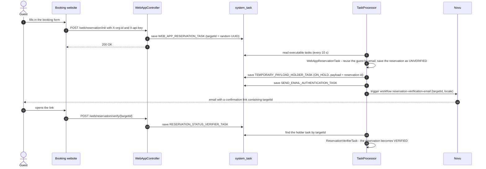
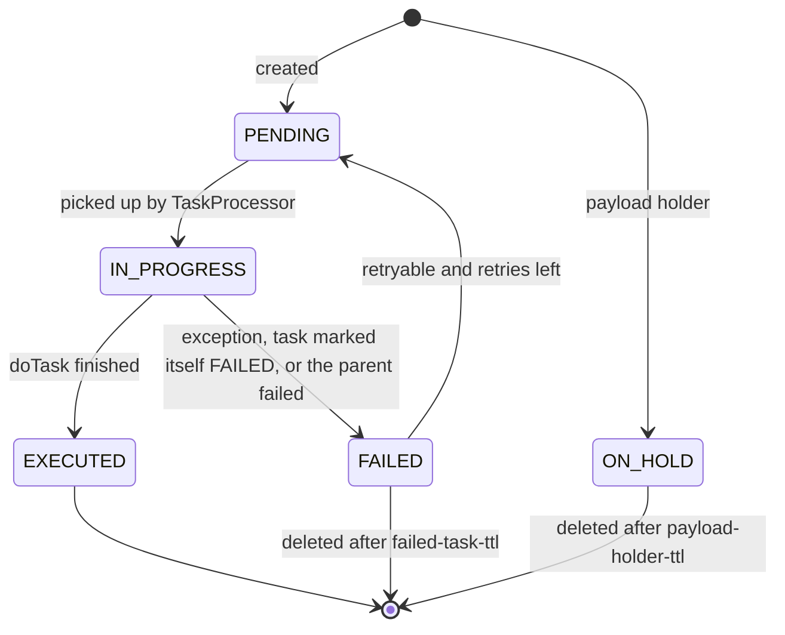

# Parceo: backend

REST API for the Parceo reservation panel (campsites and camper parks). Spring Boot 4, Java 25, MySQL, Liquibase, JWT authentication. It serves two clients:

- the **staff panel** (`../frontend`, Angular), logged in with a login and password;
- a campsite's **public booking website**, authenticated with an organisation id and API key, whose reservations are confirmed by email.

Messages returned to users (validation errors, success messages) are in Polish, because the panel is Polish.

## Contents

1. [Getting started](#getting-started)
2. [Configuration and profiles](#configuration-and-profiles)
3. [Folder structure](#folder-structure)
4. [Domain model](#domain-model)
5. [API](#api)
6. [Security](#security)
7. [Searching: `findBy` and `SearchCriteria`](#searching-findby-and-searchcriteria)
8. [Reservations: rules, prices and statuses](#reservations-rules-prices-and-statuses)
9. [Public website bookings and background tasks](#public-website-bookings-and-background-tasks)
10. [Database and migrations](#database-and-migrations)
11. [Errors](#errors)
12. [Tests](#tests)
13. [Build and deployment](#build-and-deployment)
14. [Known limitations](#known-limitations)

---

## Getting started

Requirements: JDK 25, Docker (for MySQL and for the integration tests). Maven is not needed, the wrapper (`./mvnw`) downloads it.

| Command | What it does |
|---|---|
| `docker compose up -d database` | starts MySQL 9.1 on `localhost:3306` with the `dev_camper_park_sf` database (`compose.yaml`) |
| `./mvnw spring-boot:run` | starts the API on `http://localhost:8080` with the `dev` profile; Liquibase creates the schema and loads demo data |
| `./mvnw test` | unit tests (`*Test`) |
| `./mvnw verify` | unit and integration tests (`*IT`, `*E2EIT`); needs Docker (Testcontainers) |
| `./mvnw clean package -DskipTests` | builds `target/demo-0.0.1-SNAPSHOT.jar` |
| `../start-local.sh` | starts the whole stack: database, backend and frontend dev server |

- Swagger UI: `http://localhost:8080/swagger-ui.html`; OpenAPI JSON: `/v3/api-docs`. The frontend generates its API client from this spec (`frontend/src/app/api-spec.json`).
- Demo users, their campsite („Leśna Polana”), guests, places and reservations come from `src/main/resources/database/demo/` (Liquibase context `dev`).

## Configuration and profiles

| File | Profile | Contents |
|---|---|---|
| `application.properties` | all | default profile `dev`, Liquibase on, `ddl-auto=validate`, JSON compression, JWT lifetime (24 h), task schedule |
| `application-dev.properties` | `dev` | local MySQL, dev RSA keys and Novu key, SQL/security debug logging, Liquibase contexts `prod,dev` |
| `application-prod.properties` | `prod`, `stage`, `migration-test` | everything from environment variables, logs to `/var/log/camper_park/<profile>` |
| `src/test/resources/application-test.properties` | `test` | test keys, schedulers effectively off (1 h delay), Liquibase context `prod` |

Production environment variables:

| Variable | Used for |
|---|---|
| `SPRING_PROFILES_ACTIVE` | profile and Liquibase context |
| `DB_HOST`, `DB_PORT`, `DB_NAME`, `DB_USERNAME`, `DB_PASSWORD` | MySQL connection (in Docker the `SPRING_DATASOURCE_*` variables from `compose-prod.yaml` take precedence) |
| `RSA_PRIVATE_KEY`, `RSA_PUBLIC_KEY` | location of the PEM keys that sign and verify JWTs |
| `NOVU_SECRET_KEY`, `NOVU_SERVER_URL` | Novu, which sends the confirmation emails |

Application settings (`parceo.*`):

| Property | Default | Meaning |
|---|---|---|
| `parceo.jwt.exiration-time` | `86400000` (24 h) | token lifetime in ms (the key name has a typo, keep it) |
| `parceo.task.max-retry-count` | `5` | attempts for retryable background tasks |
| `parceo.task.process-tasks.fixed-delay` | `10000` | how often pending tasks are run (ms) |
| `parceo.task.reservation-status-update-task.fixed-delay` | `60000` | how often reservation statuses are recalculated (ms) |
| `parceo.task.cleanup-task.fixed-delay` | `300000` | how often old tasks are removed (ms) |
| `parceo.task.cleanup-task.payload-holder-ttl` | `15m` | how long an unconfirmed website booking can be confirmed |
| `parceo.task.cleanup-task.failed-task-ttl` | `30d` | how long failed tasks are kept |

The dev RSA key pair in `src/main/resources/dev_rsa/` and the keys in the dev and test properties are for local use only. Production keys come from Jenkins credentials.

## Folder structure

```
src/main/java/pl/parceo/
├── ParceoApplication.java        entry point; enables JPA repositories, scheduling, RSA config
├── configuration/
│   ├── AppConfig.java            thread pool for @Async
│   ├── auth/                     SecurityConfig (filter chain, JWT encoder/decoder), RsaConfig
│   ├── notification/             Novu client bean
│   └── swagger/                  OpenAPI with the bearer token scheme
├── controller/                   REST controllers, thin: validate input, call a service, map to DTOs
├── exception/                    domain exceptions and GlobalExceptionHandler
├── model/
│   ├── entity/                   JPA entities (all extend DbObject: id, createdAt, updatedAt)
│   ├── dto/                      API records (ReservationDTO, GuestDTO, SearchRequest…)
│   └── constant/                 enums: statuses, roles, task types, search operations, countries
├── repository/                   Spring Data repositories (CRUDRepository = JPA + Specifications)
└── service/
    ├── auth/                     JwtService, WebAppAuthFilter (website API key)
    ├── core/                     business services built on CRUDServiceImpl, search, price calculation
    ├── processor/                background task processor and the tasks it runs
    ├── notification/             Novu workflow ids
    ├── validator/                @CountryIso
    └── util/                     DtoMapper (entity → DTO)

src/main/resources/
├── application*.properties
├── liquibase-changelog.xml       includes schema, migrations (context prod) and demo data (context dev)
├── database/schema.sql           tables and constraints
├── database/mig/<date>/          data migrations from the previous version of the app
├── database/demo/                demo data
└── dev_rsa/                      local JWT key pair
```

Layering: **controller → service → repository**. Controllers never touch repositories. Every service extends `CRUDServiceImpl<T>`, which gives `findBy` (search), `findAll`, `findById`, `create`, `update`, `delete` and sorts by `updatedAt` descending when the caller sends no sort.

## Domain model



Every entity extends `DbObject` (`id`, `createdAt`, `updatedAt`, filled in by `@PrePersist` / `@PreUpdate`). Tasks refer to reservations only through their JSON payload, not a foreign key.

| Entity | Table | Notes |
|---|---|---|
| `Organisation` | `organisation` | a campsite: name, address, phone and email (optional), owner, hashed API key of its booking website |
| `User` | `app_user` | `login` (unique, used to log in), `username` (display name), `email`, BCrypt `password`, `role`: `OWNER`, `ADMIN`, `REGULAR`, `WEB_APP`; belongs to an organisation |
| `CamperPlaceType` | `camper_place_type` | e.g. "Kamper, prąd"; unique `typeName` and a price per night |
| `CamperPlace` | `camper_place` | `index` (column `number`, unique, must start with a digit) and type; its own `price` is optional and overrides the type's price |
| `Guest` | `guest` | name, unique email (optional), phone, car registration, country (ISO code) |
| `Reservation` | `reservation` | `checkin`, `checkout`, place, guest, `price`, `paid`, `reservationStatus`, `creator` (the user or website that created it), `notes` (optional, up to 500 characters) |
| `Task` | `system_task` | background job: type, status, JSON payload, `targetId`, parent task, retry count |

A stay occupies the nights `[checkin, checkout)`: a guest can arrive on the day another one leaves.

## API

All endpoints except `/auth/login` and the Swagger pages need a bearer token. Lists use Spring's `Pageable` query parameters (`page`, `size`, `sort=field,asc|desc`); without them every row is returned.

| Method and path | Purpose |
|---|---|
| `POST /auth/login` | `{login, password}` → `{message, token}` |
| `GET /user` | the logged-in user |
| `GET /organisation` | the logged-in user's campsite (`OrganisationDTO`: id, name, address, phone, email; never the owner or the API key) |
| `POST /reservation/findBy` | search reservations (`SearchRequest`), paged |
| `POST /reservation` | create a reservation |
| `PATCH /reservation` | update a reservation (by `id` in the body) |
| `DELETE /reservation/{id}` | delete a reservation |
| `POST /guest/findBy`, `GET /guest/{id}` | search guests, one guest |
| `POST /guest`, `PATCH /guest`, `DELETE /guest/{id}` | create, update, delete a guest (deleting a guest deletes their reservations) |
| `POST /camperPlace/findBy` | search camper places |
| `GET /camperPlace/{typeId}` | places of a type that have their own price |
| `GET /camperPlace/available/{from}/{to}` | places free for the whole stay |
| `GET /camperPlace/occupancy/{cpId}` | occupied nights from today on, one list of dates per reservation |
| `GET /camperPlace/calcPrice/{cpId}/{checkin}/{checkout}` | price of a stay from the price list |
| `POST /camperPlace`, `PATCH /camperPlace`, `DELETE /camperPlace/{id}` | create a place (index generated when empty), update a list of places, delete |
| `GET /camperPlaceType` | all place types |
| `POST /camperPlaceType`, `DELETE /camperPlaceType/{id}` | create, delete (refused while places use the type) |
| `PATCH /camperPlaceType?cpIdToOverride=…` | update types; places listed in `cpIdToOverride` drop their own price and follow the type's new price |
| `GET /statistics/revenue/{month}/{year}` | revenue per place, `[paid, unpaid]`; `0` means any month / year |
| `GET /statistics/countryDistribution/{month}/{year}` | guests per country |
| `POST /web/reservation/init` | website: start a booking (see [below](#public-website-bookings-and-background-tasks)) |
| `POST /web/reservation/verify/{targetId}` | website: confirm a booking from the email link |

Write endpoints answer `{"success": "<message in Polish>"}`; the panel shows the message to the user. Dates are `YYYY-MM-DD`.

## Security

- **Staff panel:** `POST /auth/login` checks the login and BCrypt password (`DaoAuthenticationProvider` with `UserService`) and returns a JWT signed with the RSA private key (`JwtService`): subject = login, claim `scope` = the user's role, lifetime `parceo.jwt.exiration-time`. Requests carry `Authorization: Bearer <token>`; Spring's OAuth2 resource server verifies it with the public key. Sessions are stateless.
- **Booking website:** `WebAppAuthFilter` runs before the bearer token filter. When a request has the `X-org-id` and `X-api-key` headers, it compares the key with the organisation's hashed `webAppApiKey` and signs the request in as that organisation's `WEB_APP` user. Successful checks are cached for 5 minutes (Caffeine); wrong credentials end with `401`.
- **Access rules** (`SecurityConfig`):
  - public: `/auth/login`, `/auth/register`, Swagger, `/error`;
  - `WEB_APP` only: `POST /web/reservation/init`, `POST /web/reservation/verify/**`;
  - every role including `WEB_APP`: `GET /camperPlace/calcPrice/**`, `/occupancy/**` and `/available/**`, so the website can show free places and prices;
  - everything else: `OWNER`, `ADMIN` or `REGULAR`.
- CSRF and CORS are disabled. The panel must call the API from the same origin (the frontend dev server proxies `/api/*` to `localhost:8080`; in production the web server does the same).

## Searching: `findBy` and `SearchCriteria`

Every `POST /<resource>/findBy` takes:

```json
{
  "searchCriteria": [
    {"key": "lastname", "joinObject": "guest", "operation": "LIKE", "value": "nowak", "joinOperator": "OR"},
    {"key": "checkin", "operation": "BETWEEN", "value": "2026-10-01", "secondValue": "2026-10-31", "joinOperator": "AND"}
  ]
}
```

- `key` is an entity field; `joinObject` joins **one** related entity first (e.g. `guest`, `camperPlace`).
- Operations: `EQUALS`, `NOT_EQUALS`, `LESS_THEN`, `GREATER_THEN`, `BETWEEN` (needs `secondValue`), `LIKE` (case-insensitive "contains").
- Values are strings, converted to the field's type (`LocalDate`, `BigDecimal`, numbers, booleans, enums). A bad value gives `400` with "Nieprawidłowa wartość filtra".
- `GenericSpecification` turns one criterion into a JPA predicate; `CRUDServiceImpl` chains them **in order from the left without brackets**: `((a OR b) AND c) AND d`. The `joinOperator` of a criterion says how it joins the ones before it.
- An empty list, or any criterion with an empty `key`, returns everything.

In Java, build criteria with the fluent builder:

```java
SearchCriteria.builder()
        .joinObject("guest").key("id").operation(EQUALS).value("12")
        .and()
        .key("reservationStatus").operation(EQUALS).value("UNVERIFIED")
        .build();
```

## Reservations: rules, prices and statuses

`ReservationService.create` / `update`:

- refuses a stay that ended in the past, a departure before arrival, or less than one night;
- refuses a stay that overlaps another reservation on the same place (`checkin < other.checkout AND checkout > other.checkin`; when updating, the reservation itself is ignored): "Parcela jest już zajęta!";
- creates the guest, or updates it when the request carries a guest `id`;
- sets the creator to the logged-in user (or the website user for website bookings);
- **calculates the price** with `ReservationCalculatorService`: the place's price per night (its own price or its type's), with a fixed discount of 10 for every night after the third. The price always comes from the price list: `price` in the request is ignored (it stays in `ReservationDTO` for responses), and `WebAppController` also clears it from website bookings;
- on update, recalculates the price and status only when the dates or the place changed; otherwise the saved price stays;
- saves `notes` on create and update (`@Size(max = 500)`).

Statuses (`ReservationStatus`):



| Status | Meaning |
|---|---|
| `COMING` | arrival in the future |
| `ACTIVE` | the guest is on site (`checkin ≤ today < checkout`) |
| `EXPIRED` | the stay has ended |
| `UNVERIFIED` | website booking waiting for the guest to confirm the email |
| `VERIFIED` | website booking confirmed by the guest |

`ReservationStatusUpdateTask` runs every minute and moves reservations between `COMING`, `ACTIVE` and `EXPIRED` with one `UPDATE`; `UNVERIFIED` reservations are left alone. Payment is a separate flag (`paid`). The staff panel hides `UNVERIFIED` and `VERIFIED` reservations.

## Public website bookings and background tasks

A booking from the campsite's website is confirmed by the guest by email before it counts. The work is done by background tasks stored in `system_task`, so a failure (e.g. the email service is down) can be retried and nothing is lost on restart.



- When the same guest sends the same dates again, the existing `UNVERIFIED` reservation is reused and the email is sent again.
- `TaskCleanupTask` (every 5 minutes) deletes holder tasks older than `payload-holder-ttl` (15 minutes), so a link can only be used within that time, and failed tasks older than `failed-task-ttl` (30 days).

**Task processor** (`service/processor`):

- `TaskProcessor.processTasks()` runs on a schedule, takes tasks that are `PENDING` or `FAILED` and retryable (with `executionDate` in the past or empty), and builds them into trees by `parentTask` (`TaskGatherer`, a stream `Gatherer`).
- Every tree runs on a virtual thread; a task's children run only after it succeeded. If a task fails, its descendants are marked `FAILED` too.
- A failed retryable task is retried until `parceo.task.max-retry-count`; then it stays `FAILED` with a message.
- Statuses: `PENDING`, `IN_PROGRESS`, `EXECUTED`, `FAILED`, `ON_HOLD` (waits for something else, e.g. the guest's click):



- **Adding a task type:** add a value to `TaskType` (with `retryable`), implement `ExecutableTask.doTask()`, and return it from `ExecutableTaskFactory`. Set the task's status to `FAILED` with a message to stop it without an exception.

## Database and migrations

- MySQL (9.1 locally and in production, 8.0 in tests). Hibernate only validates the schema (`ddl-auto=validate`); **all changes go through Liquibase**.
- `liquibase-changelog.xml` includes:
  - `database/schema.sql`: all tables, unique keys and foreign keys (formatted SQL changesets);
  - `database/mig/<dd-MM-yy>/…` (context `prod`): one-time data migrations from the previous version of the app (users split into guests, place types, creators, organisations);
  - `database/demo/…` (context `dev`): demo data, loaded only into an empty database.
- The active contexts come from `spring.liquibase.contexts`: `prod,dev` locally, the profile name in production, `prod` in tests.
- **A schema change:** add a new changeset (to `schema.sql` or a new file included in the changelog) with a new id. Never edit a changeset that has already run: Liquibase checks its checksum and stops the app.
- Notable constraints: unique place number, unique type name, unique guest email, unique user login and email, one organisation per owner, unique API key.

## Errors

`GlobalExceptionHandler` turns exceptions into plain-text responses with a Polish message:

| Exception | Status | When |
|---|---|---|
| `UserInputException` (incl. `DateValidationException`) | 400 | a business rule was broken (occupied place, bad dates, duplicate number…) |
| `MethodArgumentNotValidException` | 400 | Bean Validation failed on a DTO |
| `ClientSideException` | 400 | a bad search request (unknown field, `BETWEEN` without `secondValue`) |
| `HttpMessageNotReadableException` | 400 | the body is not valid JSON |
| `BadCredentialsException` | 401 | wrong login or password |
| `AuthenticationException` | 401 | wrong website credentials, expired confirmation link |
| `AccessDeniedException` | 403 | the role may not do this |
| `IllegalStateException` | 500 | an unexpected state, e.g. a logged-in user without a campsite (`GET /organisation`); logged with the stack trace |
| anything else | 500 | logged with the stack trace |

Business rules are checked in services with `checkClientInput(condition, message)` or by throwing `UserInputException`.

## Tests

`./mvnw verify` runs everything; Docker must be running.

| Kind | Naming | Run by | Setup |
|---|---|---|---|
| unit | `*Test` | Surefire (`./mvnw test`) | Mockito, no Spring context |
| integration | `*IT` | Failsafe (`./mvnw verify`) | `BaseIT`: Spring context, MySQL from Testcontainers, profile `test` |
| end-to-end | `*E2EIT` | Failsafe | `BaseE2E`: the app on a random port, real HTTP calls |

`AbstractMySqlContainerTest` starts one MySQL container shared by all tests. Covered areas: search specifications, places and types, reservations (rules, overlaps, prices), statistics, the website auth filter, the task processor, cleanup, status updates and the whole website booking flow (Novu is mocked).

## Build and deployment

- `Dockerfile`: `eclipse-temurin:25-jdk` running the jar built by Maven (`target/demo-0.0.1-SNAPSHOT.jar`), port 8080.
- `compose-prod.yaml`: MySQL with a health check (optionally restored from a `.sql.gz` dump on first start) and the app; RSA keys are mounted read-only, logs go to `/var/log/camper_park/<profile>` on the host, and the app joins the external `novu_default` network to reach a self-hosted Novu.
- `../Jenkinsfile`: parameters `COMPONENT` (`all`, `backend`, `frontend`) and `PROFILE` (`stage`, `prod`, `migration-test`).
  - Backend: `mvn clean package -DskipTests`, then `docker compose -p camper-park-<profile> -f compose-prod.yaml up --build -d` with database credentials, RSA keys and the Novu key from Jenkins credentials. Production listens on port 2000, the other profiles on 2001.
  - `migration-test` restores the newest backup from `/home/camper_park/backups` into a fresh database, to check that the migrations run on real data before a production release.
  - Frontend: `npm run build` and a copy of `dist/browser` to `/var/www/html/parceo/<profile>`.

## Known limitations

- **A user without a campsite** gets `500` from `GET /organisation`. This is intended (inconsistent data, not a bad request), but the frontend does not handle it yet: it should log the user out and show a message.
- **The discount is hard-coded** in `ReservationCalculatorService` (10 off every night after the third) instead of being stored per organisation.
- **Search without grouping:** conditions are chained from the left, so only one leading "OR" group is possible, and `joinObject` reaches only one level (no filter by a reservation's place type).
- **Single campsite in practice:** entities are not filtered by the user's organisation yet; organisations are used only for website authentication and as reservation creators.
- **No user management:** `/auth/register` is commented out (but still public in `SecurityConfig`), and there is no endpoint for the organisation's users. The organisation's details can be read (`GET /organisation`) but not changed yet.
- `SecurityConfig` lists `/camperPlace/findBy` among the `GET` paths open to the website, but the endpoint is `POST`, so the website cannot use it.
- `Dockerfile` still uses the old artifact and folder names (`demo-0.0.1-SNAPSHOT.jar`, `/var/log/camperparkstaryfolwark`), while `compose-prod.yaml` and the prod properties log to `/var/log/camper_park`.
- `HELP.md` is the default Spring Initializr file and can be removed.
