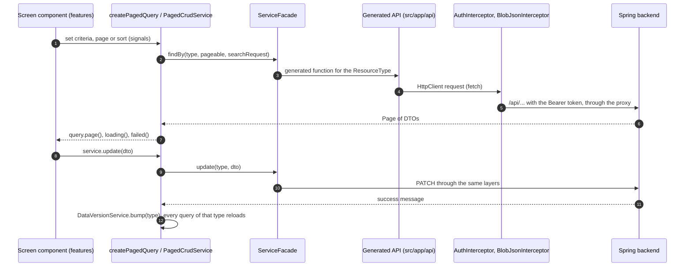
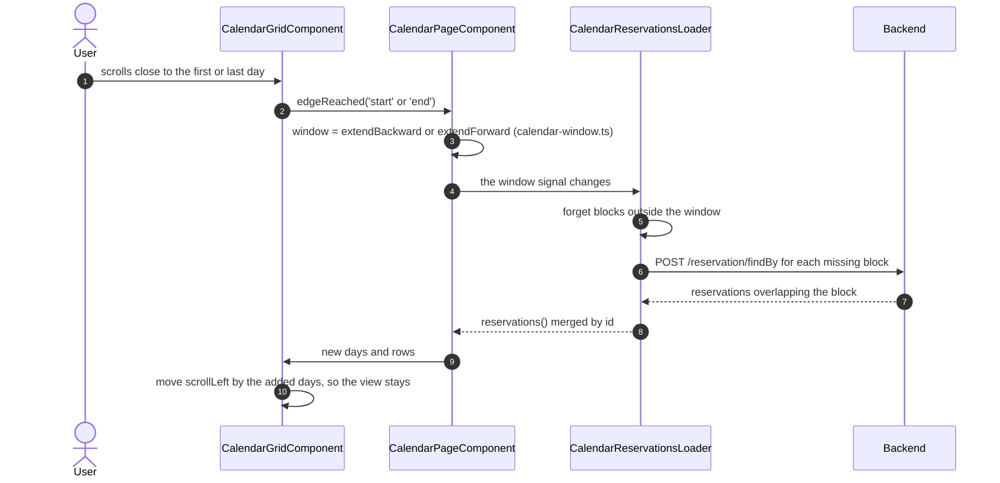
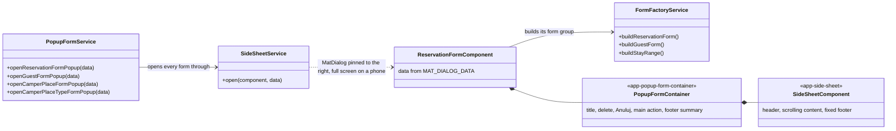

# Parceo: frontend

Reservation panel for campsites and camper parks. Angular 22, Angular Material 22 (Material 3), standalone components, signals.

The user interface is in Polish; labels quoted below (e.g. „Dziś”, „Opłacona”) are the exact texts shown on screen.

## Contents

1. [Getting started](#getting-started)
2. [Folder structure](#folder-structure)
3. [Data flow: from a screen to the backend](#data-flow-from-a-screen-to-the-backend)
4. [Reading data](#reading-data)
5. [Saving data and refreshing lists](#saving-data-and-refreshing-lists)
6. [Search criteria](#search-criteria)
7. [Forms and the side sheet](#forms-and-the-side-sheet)
8. [Reusable components](#reusable-components)
9. [Domain logic (`shared/domain`)](#domain-logic-shareddomain)
10. [Theme, styles and device settings](#theme-styles-and-device-settings)
11. [Login, routes and security](#login-routes-and-security)
12. [Mocks](#mocks)
13. [Tests](#tests)
14. [Conventions and recipes](#conventions-and-recipes)

---

## Getting started

| Command | What it does |
|---|---|
| `npm start` | dev server on `http://localhost:4200`; `/api/*` requests go through the proxy (`src/proxy.conf.json`) to `http://localhost:8080` |
| `npx ng build --configuration development` | build without optimisations |
| `npm run build` | production build; **needs internet access**, because Angular downloads and inlines the Google fonts (Roboto, Material Symbols) |
| `CHROME_BIN=/usr/bin/google-chrome npx ng test --watch=false --browsers=ChromeHeadless` | unit tests (Karma + Jasmine) |
| `npm run generate-api` | regenerates the API client in `src/app/api` from `src/app/api-spec.json` (ng-openapi-gen) |

Code in `src/app/api` is never edited by hand: after a backend change, replace `api-spec.json` and run `generate-api`.

## Folder structure

```
src/
├── styles.scss              Material 3 theme, app tokens, global component overrides
├── _theme-colors.scss       tonal palettes (generated by ng generate @angular/material:theme-color)
└── app/
    ├── api/                 API client generated from api-spec.json (do not edit)
    ├── app.config.ts        providers: router, HTTP, interceptors, dates, Material, mocks
    ├── app.routes.ts        routes and redirects from old addresses
    ├── core/                single-instance pieces for the whole app
    │   ├── guards/          authGuard, guestGuard
    │   ├── i18n/            Polish paginator labels
    │   ├── interceptors/    JWT token, Blob → JSON response conversion
    │   ├── layout/          app shell (menu, account) and menu items
    │   ├── mocks/           MOCK: data the backend does not provide yet
    │   ├── models/          Page
    │   └── services/        app services and the API access layer (openApiWrappers/)
    ├── features/            screens (container components): put data from services together
    │   ├── auth/            login
    │   ├── today/           Dziś (start page)
    │   ├── calendar/        occupancy calendar
    │   ├── reports/         reports
    │   ├── reservations/    reservations table (used on the Dziś screen)
    │   └── settings/        settings: campsite, places and prices, staff, appearance
    └── shared/
        ├── domain/          pure business logic functions (no Angular), with tests
        ├── form/            edit forms (reservation, guest, camper place, place type) and the form factory
        ├── popups/          confirmation dialog, snackbar
        ├── ui/              reusable presentational components
        ├── constants/       country list
        └── helper/          DateFormater (moment.js)
```

The split: **`features/` knows where the data comes from** (injects services, builds queries), **`shared/ui/` knows nothing about the backend** (gets data through `input()`, reports events through `output()`), **`shared/domain/` knows nothing about Angular** (pure functions, easy to test).

## Data flow: from a screen to the backend



Services backed by mocks (`StaffApi`, `ReservationNotesApi`, `DisplaySettingsService`) stop at the mock in `core/mocks` instead of calling `ServiceFacade`; see [Mocks](#mocks).

Screens never call `HttpClient` or the functions from `src/app/api` directly. The one exception is login (`LoginComponent` calls `login` through `Api`).

## Reading data

All reads are built on Angular's `rxResource`: a resource has `params` (signals) and a `stream` (the request). When any signal in `params` changes, the resource fetches again by itself and cancels the previous request.

### 1. Lists: `createPagedQuery()` (the recommended way)

`core/services/openApiWrappers/paged-query.ts`. Every list on a screen has **its own** query. Create it in a component field initialiser, because it needs an injection context:

```ts
export class TodayPageComponent {
  protected readonly arrivals = createPagedQuery<ReservationDto>(ResourceType.RESERVATION, {pageSize: 6});
  private readonly occupancy = createPagedQuery<ReservationDto>(ResourceType.RESERVATION, {unpaged: true});

  constructor() {
    this.arrivals.criteria.set([{key: 'checkin', operation: 'EQUALS', value: todayIso(), joinOperator: 'AND'}]);
  }
}
```

A query (`PagedQuery<T>`) exposes:

| Field | Type | Description |
|---|---|---|
| `criteria` | `WritableSignal<SearchCriteria[]>` | search criteria (see [Search criteria](#search-criteria)) |
| `pageIndex`, `pageSize` | `WritableSignal<number>` | server-side paging |
| `sort` | `WritableSignal<QuerySort \| null>` | `{field: 'guest.lastname', direction: 'ASC'}`; `field` is a path in the backend entity |
| `page` | `Signal<Page<T>>` | the result; **an empty page on error** (see below) |
| `loading`, `failed` | `Signal<boolean>` | state for a progress bar and an error message |
| `reload()` | | forces a new fetch |

Options: `pageSize`, `sort` (default sorting), `unpaged: true` (all rows in one response; used by the calendar, the occupancy on the Dziś screen and the reports).

A query refreshes itself when data of its type changes anywhere in the app (see [Saving data](#saving-data-and-refreshing-lists)).

### 2. Shared reference data in services

Data needed in many places at once is kept by services in a single resource:

- `CamperPlaceService.camperPlaces()`: all camper places sorted by number (calendar, reports, forms, settings). Refreshes after a change to places **and** place types, because changing a type's price can overwrite place prices.
- `CamperPlaceTypeService.page()`: all place types (the backend has no paged endpoint for them, so the facade wraps the list in a single page).
- `UserService.user()`: the logged-in user (`GET /user`, `UserDto`).
- Both `UserService` and `OrganisationService` depend on `SessionService.token()`: they load after login, clear after logout and load again when another user logs in in the same tab.
- `OrganisationService.organisation()` and `.name()`: the logged-in user's campsite (`GET /organisation`: name, address, phone, email). Read-only for now; the menu shows „Mój kemping” until the data arrives. `.logoIcon` is the Material Symbols icon used as the campsite's logo (`camping`); a campsite's own SVG can replace it later.
- `DisplaySettingsService`: the logged-in user's display settings (mock): `calendarDays()` (how many days the calendar shows, 30 by default) and `calendarScrollDays()` (how many days the arrows scroll, 7 by default). While the settings load, the signals hold the defaults.

### Calendar: loading in blocks

The calendar scrolls without end, so it does not fetch all reservations at once:



- A block has as many days as `calendarDays()`. The window starts with 3 blocks and today in the middle. It holds at most 5 blocks (`MAX_BLOCKS`); scrolling further drops a block on the other side.
- `CalendarReservationsLoader` (provided by the page) fetches only missing blocks, merges reservations by `id` (a stay across two blocks appears once), forgets blocks outside the window and reloads all of them after a change in `DataVersionService`. When a block fails to load, the previous data stays and a message appears.
- The grid has no scrollbar (it jumped while days were added). It scrolls with a finger, a touchpad, by dragging with the mouse (`DragScrollDirective`) and with the arrows.
- After days are added before the first day, the grid moves `scrollLeft` by their width, so the view does not jump. Day width = (grid width − place column) / `calendarDays()`, at least 32 px.
- „Dziś” scrolls to today; when today is outside the window, the window starts again around today.

### 3. One-off requests

Methods returning an `Observable` for endpoints that are not lists:

```ts
camperPlaceService.getAvailable(checkin, checkout)     // GET /camperPlace/available/{from}/{to}
camperPlaceService.getOccupiedNights(camperPlaceId)    // GET /camperPlace/occupancy/{id}
camperPlaceService.getPrice(camperPlaceId, checkin, checkout)  // GET /camperPlace/calcPrice/...
```

The reservation form wraps them in its own `rxResource`s, so free places, occupied nights and the price recalculate by themselves when the dates or the place change.

### 4. Safe reads: `safePage()`

In Angular 22, `resource.value()` **throws** when the resource is in the error state, and an exception in a template stops rendering of the whole app. That is why lists are always read through:

- `query.page()` (queries from `createPagedQuery`),
- `service.page()` (`PagedCrudService` resources),
- `safePage(resource)` / `emptyPage()` from `page-utils.ts` (custom resources).

All of them return an empty page on error, and the error message is shown based on `failed()` / `status() === 'error'`.

### 5. Older mechanism: `pageable` / `searchRequest` in `PagedCrudService`

`PagedCrudService` still has the shared `pageable` and `searchRequest` signals and a `pageResource` built from them. Only the guest suggestions in the reservation form (`GuestService`) and the place type list (`CamperPlaceTypeService`) still use them. New lists are built with `createPagedQuery`: shared signals in an app-wide service made two lists on one screen overwrite each other's queries.

## Saving data and refreshing lists

Writes go through the `PagedCrudService` methods (inherited by `ReservationService`, `GuestService`, `CamperPlaceService`, `CamperPlaceTypeService`):

```ts
this.reservations.update({...reservation, paid: true}).subscribe();
```

After a success, `create` / `update` / `delete` automatically:

1. reload the service's resources (`reloadResources()`, overridden in subclasses),
2. bump the counter in **`DataVersionService`** for the given `ResourceType`,
3. show a success snackbar with the backend message (`NotificationService`); on failure an error snackbar.

`DataVersionService` is a change counter per resource type. `createPagedQuery` reads it in its `params`, so **every list of that type on every screen reloads by itself** after a change made anywhere (e.g. „Opłacona” on the „Do zapłaty” card also refreshes the reservations table and the calendar). Components never need to refresh anything by hand.

## Search criteria

The backend accepts `SearchRequest { searchCriteria: SearchCriteria[] }`:

```ts
{key: 'checkin', operation: 'BETWEEN', value: '2026-10-01', secondValue: '2026-10-31', joinOperator: 'AND'}
{key: 'lastname', joinObject: 'guest', operation: 'LIKE', value: 'Nowak', joinOperator: 'OR'}
```

Operations: `EQUALS`, `NOT_EQUALS`, `LESS_THEN`, `GREATER_THEN`, `BETWEEN`, `LIKE`. `joinObject` reaches **one** level deep (e.g. `guest`).

**Important backend limitation:** conditions are combined in order from the left, without brackets: `((a OR b) AND c) AND d`. Therefore:

- there can be only one "OR" group and it must come **first** (this is how the reservations table search works: first name OR last name OR registration, then the filters with "AND");
- fields two levels deep cannot be filtered (e.g. the place type of a reservation).

`ServiceFacade.findBy` for reservations always appends conditions at the end that exclude unverified reservations from the website (`UNVERIFIED`, `VERIFIED`).

The reservations table criteria are built by the pure function `reservationCriteria(view, filters, search, today)` in `shared/domain/reservation-query.ts`; the same file defines the views („Aktywne rezerwacje”, „Nadchodzące przyjazdy”…) with their default sorting, and the filter groups.

## Forms and the side sheet



`GuestFormComponent`, `CamperPlaceFormComponent` and `CamperPlaceTypeFormComponent` are built the same way as `ReservationFormComponent`.

- **`FormFactoryService`** builds form groups (`buildReservationForm`, `buildGuestForm`, `buildStayRange`, `buildCamperPlaceForm`, `buildCamperPlaceTypeForm`) with validators. A required field = the `required` validator + the `required` attribute on the input (Material adds the asterisk to the label).
- **Reservation form** (`shared/form/reservation-form.component.*`):
  - the stay is a `DateRangeFieldComponent` with a `stay {start, end}` group;
  - place list: all places before dates are picked, then only free ones (`getAvailable`, plus the edited place when editing);
  - the `freeStayValidator` validator blocks dates overlapping occupied nights of the chosen place (`getOccupiedNights`; without the reservation's own stay when editing);
  - the price is filled in from the price list (`getPrice`); after a manual change it stays, and below the field the discount or surcharge is shown together with „Przywróć cenę z cennika”;
  - guest: „Nowy gość” (`GuestFieldsComponent`) or „Był już u nas” (suggestions by last name);
  - saving needs no extra question; deleting goes through the confirmation dialog.
- **Confirmation dialog**: `PopupConfirmationService.openConfirmationPopup({title, message, confirmLabel, tone: 'danger', action})`. The title is a question („Usunąć rezerwację?”), the message says exactly what the change affects.
- **Notifications**: `NotificationService.success(…) / warning(…) / error(…)` (snackbar with an icon, colours through `mat.snack-bar-overrides`).

## Reusable components

All are standalone, `OnPush`, with `input()` / `output()`. They do not inject data services.

### `shared/ui`

| Component | Selector | Purpose | Main inputs / outputs |
|---|---|---|---|
| `DataTableComponent<T>` | `app-data-table` | table with server-side sorting and paging, progress bar, error state and empty state | in: `columns`, `rows`, `total`, `pageIndex`, `pageSize`, `sort`, `loading`, `failed`, `rowLabel`; out: `sortChange`, `pageChange`, `rowClick`; slots `[tableToolbar]`, `[tableEmpty]` |
| `CellDefDirective` | `ng-template[appCell]` | custom cell template for a column | `<ng-template appCell="status" let-row>` |
| `FilterBarComponent` | `app-filter-bar` | „Pokaż” field (views + saved filters), „Dodaj filtr” (popover with groups), filter chips, „Zapisz filtr” | in: `views`, `savedViews`, `activeViewId`, `groups`, `filters`; out: `viewChange`, `filtersChange`, `saveFilter(name)`, `deleteSavedView` |
| `SaveFilterDialogComponent` | (dialog) | asks for the filter name, with a summary | opened by `FilterBarComponent` |
| `DateRangeFieldComponent` | `app-date-range-field` | arrival and departure in one field, hint „3 noce, od soboty do wtorku”, message when the stay overlaps another reservation (occupied nights and today are not marked in the picker) | in: `group` (`StayRangeGroup`), `label` |
| `SideSheetComponent` | `app-side-sheet` | side sheet layout | in: `title`, `deletable`, `deleteLabel`; out: `deleteClicked`; slot `[sheetFooter]` |
| `StatusChipComponent` | `app-status-chip` | reservation status as a word, an icon and a colour | in: `kind` (`arrive`, `stay`, `leave`, `ended`, `late`, `unpaid`) |
| `PageHeaderComponent` | `app-page-header` | page title, description, actions (content projection) | in: `title`, `description` |
| `EmptyStateComponent` | `app-empty-state` | what is empty and what to do next | in: `title`, `message`, `icon`; action through content projection |
| `BarChartComponent` | `app-bar-chart` | a single series of bars, axis with round values, tooltip, hidden table for screen readers | in: `bars` (`ChartBar[]`), `label`, `formatTick` |
| `DonutChartComponent` | `app-donut-chart` | donut chart with a legend and shares | in: `slices` (`DonutSlice[]`, colours `var(--chart-1…4)`, `var(--chart-other)`), `valueLabel`, `totalLabel` |
| `ParceoLogoComponent` | `app-parceo-logo` | the Parceo mark in theme colours | in: `size`, `showName` |
| `MockNoticeComponent` | `app-mock-notice` | notice that mock data is saved only in this browser | default text or content projection |
| `DragScrollDirective` | `[appDragScroll]` | sideways scrolling by dragging with the mouse (touch and touchpad scroll natively); a drag does not click what it started on | directive on the scrolling element |

Table example (from `features/reservations/reservations-table`):

```html
<app-data-table [columns]="columns" [rows]="rows()" [total]="query.page().totalElements"
                [pageIndex]="query.pageIndex()" [pageSize]="query.pageSize()" [sort]="query.sort()"
                [loading]="query.loading()" [failed]="query.failed()"
                (sortChange)="changeSort($event)" (pageChange)="changePage($event)" (rowClick)="open($event)">
  <div tableToolbar>…search field and <app-filter-bar>…</div>

  <ng-template appCell="status" let-row>
    <app-status-chip [kind]="row.status" />
  </ng-template>

  <app-empty-state tableEmpty title="Brak rezerwacji dla tych filtrów." />
</app-data-table>
```

```ts
const COLUMNS: readonly ColumnDef[] = [
  {key: 'guest', label: 'Gość', sortField: 'guest.lastname'},   // sortField = entity field in the backend
  {key: 'nights', label: 'Noce', align: 'end'},                  // no sortField: the column is not sortable
  {key: 'actions', label: 'Akcje', hideLabel: true},
];
```

The table can also work on local data (sorting and paging in the browser), like the place list in `features/settings/places`: the component computes `rows` from `sort` / `pageIndex` itself and passes them in the same way.

### `shared/form`

| Component | Purpose |
|---|---|
| `PopupFormContainer` (`app-popup-form-container`) | form frame in the side sheet: in: `formTitle`, `proceedAction`, `deleteAction`, `isUpdate`, `saveLabel`, `saveDisabled`; slot `[formSummary]` in the footer |
| `GuestFieldsComponent` (`app-guest-fields`) | guest fields (first name, last name, phone, registration, country with a flag, email) for a group from `buildGuestForm()` |
| `ReservationFormComponent`, `GuestFormComponent`, `CamperPlaceFormComponent`, `CamperPlaceTypeFormComponent` | edit forms opened by `PopupFormService` |

### Screen components (presentational, in `features/`)

| Component | Where |
|---|---|
| `TodayListCardComponent` | the Przyjazdy / Wyjazdy / Do zapłaty cards on the Dziś screen |
| `FreeParcelsStripComponent`, `FreeParcelsDialogComponent` | free place tiles and the dialog listing free places for a night |
| `CalendarGridComponent` | scrolling calendar grid: places × days, reservation bars; in: `days`, `rows`, `visibleDays`, `initialDay`; out: `barClick`, `cellClick`, `edgeReached`, `visibleRangeChange` |
| `ReservationsTableComponent` | ready-made reservations table with search, filters and saved filters |

## Domain logic (`shared/domain`)

Pure functions with no Angular dependency. Every file has a `*.spec.ts` test. Dates throughout the logic are `YYYY-MM-DD` strings (the backend format); a stay occupies the nights `[checkin, checkout)`.

| File | Main functions |
|---|---|
| `stay-status.ts` | `stayStatus()`: ACTIVE / COMING / EXPIRED + `paid` → Przyjazd, Na miejscu, Wyjazd dziś, Zakończona, Po terminie; `showsUnpaidBadge()`; `RESERVATION_CHIP_META` (labels, icons) |
| `stay-range.ts` | `nightsBetween`, `nightsLabel` („3 noce”), `stayHint`, `nightsOf`, `firstConflict`, `withoutOwnStay`, `stayLabel`, `addDays` |
| `reservation-query.ts` | views and filters of the reservations table, `reservationCriteria()`, `filterLabels()` |
| `occupancy.ts` | `occupiesNight`, `freePlaceIdsOn`, `availabilityPerDay`, `freeNightsInARow` |
| `calendar-layout.ts` | `calendarDays`, `barTone`, `calendarBars` (bar positions in half-days) |
| `calendar-window.ts` | the calendar's window of days: `initialWindow`, `extendBackward`, `extendForward`, `blockStarts`, `containsDay`, `visibleMonthsTitle` („Październik – listopad 2026”) |
| `reports.ts` | `buildReport()` (revenue spread over nights, occupancy, by place type, countries, unpaid), `percentChange`, `topCountries` |
| `report-period.ts` | `reportPeriod()`, `previousPeriod()`, Polish phrases („we wrześniu”, „w 2025 roku”) |
| `today-summary.ts` | summary sentences of the Dziś screen |
| `plural.ts` | `plural()`, `countLabel()`: Polish plural forms („1 parcela”, „3 parcele”, „5 parcel”) |
| `money.ts` | `formatPln()` → „1 250,00 zł” |
| `countries.ts` | country names and search, `countryIso()` |
| `csv.ts` | `toCsv()` with a `;` separator and a BOM (Polish Excel) |
| `iso-date.ts` | `toIsoDate()`, `todayIso()` (from the local date, not UTC) |

## Theme, styles and device settings

- **Material 3 theme** in `src/styles.scss`: `mat.theme()` with the palettes from `_theme-colors.scss`, the Roboto font, and the exact colour roles through `mat.theme-overrides()` with `light-dark(light, dark)`.
- **Tokens** used by components:
  - `--mat-sys-*`: colours, typography, elevation levels from Material;
  - `--res-*`: reservation status colours (`--res-stay-container`, `--res-on-stay-container`, `--res-stay` etc.);
  - `--app-*`: success, warning;
  - `--chart-1…4`, `--chart-other`: chart palette checked for colour blindness in both themes;
  - `--calendar-*`, `--space-1…8`, `--radius-xs…full`.
- **Rules:** no hard-coded colours, no `!important`, no styles in the `style` attribute. Material components are changed through `mat.*-overrides()`.
- **Icons:** Material Symbols Rounded through `<mat-icon>`, set as the default set in `app.config.ts`. The icon of the active menu item is filled.
- **`ThemeService`**: Jasny / Ciemny / Jak w systemie (light / dark / system), saved in `localStorage`, `light-theme` / `dark-theme` class on `<html>` (also works for Material overlays).
- **`TextSizeService`**: Normalny / Duży / Bardzo duży (normal / large / extra large) through the `<html>` font size. Material typography is in `rem`, so all text scales.
- **Layout** (`core/layout/app-shell`): side menu 264 px (≥ 1240 px), narrow rail 88 px (600–1239 px), bottom navigation (< 600 px), chosen by `BreakpointObserver`. Menu items are in `nav-items.ts`.
- **Localisation:** moment.js with the Polish locale (`import 'moment/locale/pl'`), dates `DD.MM.YYYY`, weeks starting on Monday, Polish paginator labels (`PolishPaginatorIntl`).

## Login, routes and security

- `LoginComponent` calls `POST /auth/login`, and the token goes to `SessionService` (`sessionStorage`).
- `AuthInterceptor` adds the `Authorization: Bearer …` header to every request.
- `authGuard` lets users into the panel only with a valid token (`JwtHelperService` checks expiry), otherwise it redirects to `/logowanie?powrot=…`. `guestGuard` moves a logged-in user from the login screen to `/dzis`.
- Routes (`app.routes.ts`): `/logowanie`, `/dzis`, `/kalendarz`, `/raporty`, `/ustawienia/{kemping|parcele|pracownicy|wyglad}`. Old addresses (`/login`, `/admin-page/*`) redirect to the new ones.

## Mocks

Data the backend does not provide yet is mocked in the frontend.

- Every mock is a file in `core/mocks/` marked with a `MOCK` comment.
- Every mock has an **abstract API** that screens and services use:

| Abstract API | Mock | Used by | Remove when the backend has |
|---|---|---|---|
| `StaffApi` | `StaffMockApi` | `SettingsStaffComponent` (invitations) | a list of the campsite's users, invitations and registration (`/auth/register` is commented out today) |
| `ReservationNotesApi` | `ReservationNotesMockApi` | `ReservationFormComponent` (Uwagi) | a `notes` field in `Reservation` / `ReservationDTO` |
| `DisplaySettingsApi` | `DisplaySettingsMockApi` | `DisplaySettingsService` (days in the calendar, arrow step) | GET / PUT for the logged-in user's display settings, stored per user |

- Registration: `core/mocks/provide-mocks.ts`, wired into `app.config.ts`. **Moving to the backend** means writing a class that implements the given API (e.g. `StaffHttpApi extends StaffApi`, calling the endpoint through `Api`), or calling the generated function directly from the service and deleting the mock, as `OrganisationService` does with `getOrganisation`, and swapping it in `provideMocks()`. Screens do not change.
- Mock data is saved in `localStorage` with the `parceo.mock.` prefix (`mock-storage.ts`).
- Screens based on a mock show `<app-mock-notice>`.

## Tests

Run: `CHROME_BIN=/usr/bin/google-chrome npx ng test --watch=false --browsers=ChromeHeadless`.

- **Domain logic:** full coverage of the functions in `shared/domain` (statuses, nights, date conflicts, occupancy, calendar layout, reports, periods, plural forms, amounts, CSV, search criteria).
- **Components:** `DataTableComponent`, `FilterBarComponent`, `StatusChipComponent`, confirmation dialog, snackbar, login, `AppComponent`.
- **Interceptor:** adding the token.

Component tests check behaviour (what the user sees, which events the component reports), not just "should create".

## Conventions and recipes

**Rules:**

- Standalone components, `ChangeDetectionStrategy.OnPush`, `input()` / `output()` / `model()`, no `any` in a public API.
- A container in `features/` injects services and builds queries; a component in `shared/ui/` only displays and reports events.
- Logic without Angular goes to `shared/domain/` together with a test.
- UI texts in Polish, in sentence case („Zapisz rezerwację”, not „Zapisz Rezerwację”); errors say what to fix („Podaj numer telefonu.”).
- Statuses always with a word and an icon, never colour alone; icon-only buttons have an `aria-label`.

**A new list on a screen:**

1. In the component: `protected readonly query = createPagedQuery<Dto>(ResourceType.X, {sort: …});`
2. Set criteria in `query.criteria` (constant ones in the constructor, signal-dependent ones in an `effect` + `untracked`).
3. Show it with `<app-data-table>` using `query.page()`, `query.loading()`, `query.failed()`; cells through `appCell`.
4. Refreshing after changes works by itself (`DataVersionService`).

**A new edit form:**

1. A group in `FormFactoryService`.
2. A component with `<app-popup-form-container [formTitle] [proceedAction] [deleteAction] [isUpdate]>` and data from `MAT_DIALOG_DATA`.
3. An opening method in `PopupFormService` (through `SideSheetService.open`).
4. Saving through a service method from `PagedCrudService`; deleting through `PopupConfirmationService` with `tone: 'danger'`.

**A new resource type in the backend:**

1. `npm run generate-api` after updating `api-spec.json`.
2. A value in `ResourceType` and branches in `ServiceFacade` (`findBy`, `create`, `update`, `delete`).
3. A service that `extends PagedCrudService` with `getType()`. A resource that is only read as a single object (like `GET /user` or `GET /organisation`) gets a plain service with one `rxResource` instead (see `UserService`, `OrganisationService`).
